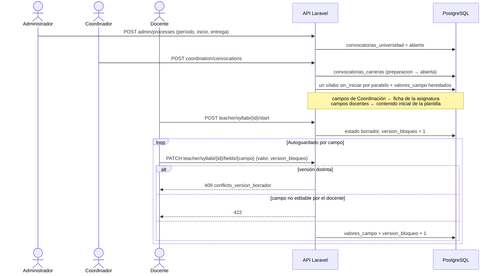

# Secuencias

Flujos principales tal como los implementa el código. En todos, la acción autoriza,
abre una transacción, bloquea las filas que cambia, audita y guarda las notificaciones
antes del commit. Los trabajos en cola salen después del commit.

## 1. Elaboración



- Abrir la convocatoria exige el proceso abierto, la carrera lista
  (`CoordinatorConvocationReadiness`) y una plantilla usable.
- El docente puede copiar el contenido de otro paralelo suyo de la misma asignatura
  hacia un sílabo que aún no envió (`POST …/copy-from/{source}`).
- El docente edita campos `docente` y los de Coordinación con el permiso de la ficha
  activado.

## 2. Validar y enviar

```mermaid
sequenceDiagram
    actor D as Docente
    participant API as SubmitSyllabus
    participant DB as PostgreSQL

    D->>API: POST teacher/syllabi/{id}/submit (version_bloqueo, idempotency_key)
    API->>DB: ¿ya existe una revisión con esa clave? → la devuelve
    API->>API: estado borrador o correccion_solicitada; dentro del plazo; versión igual
    API->>API: ValidateDraft (campos obligatorios y reglas de bloque)
    alt errores
        API-->>D: 422 con errores por campo
    else válido
        API->>DB: lock sílabo; revisión N con fotografía y hash SHA-256
        alt la corrección anterior la pidió Biblioteca
            API->>DB: envios_biblioteca(N) → vuelve directo a Biblioteca
        end
        API->>DB: estado en_revision; auditoría; notificación
        API-->>D: revisión N
    end
```

`POST …/validate` ejecuta solo la validación; no cambia el sílabo.

## 3. Revisión de Coordinación

```mermaid
sequenceDiagram
    actor C as Coordinador
    participant API as API
    participant DB as PostgreSQL

    C->>API: GET coordination/reviews/{revision}
    alt aprueba
        C->>API: POST …/approve
        API->>DB: revisiones_coordinacion(N) + envios_biblioteca(N)
        API->>DB: notificación a Biblioteca
    else pide corrección
        C->>API: POST …/request-correction (comentario)
        API->>DB: revisión N: correccion_* con etapa coordinacion
        API->>DB: estado correccion_solicitada; notificación al docente
    end
```

Solo se decide sobre la revisión más reciente. `GET …/compare/{after}` muestra la
diferencia entre dos revisiones.

## 4. Verificación de Biblioteca y exportación automática

```mermaid
sequenceDiagram
    actor B as Bibliotecario
    participant API as VerifyBibliography
    participant DB as PostgreSQL
    participant Q as Cola documentos
    participant G as Gotenberg

    alt aprueba la bibliografía
        B->>API: POST library/reviews/{revision}/verify
        API->>DB: aprobaciones(N); estado aprobado; auditoría; aviso al docente
        API->>DB: exportaciones_silabo pendiente (clave = id de la aprobación)
        API-->>Q: GenerateSyllabusExportJob (afterCommit)
        Q->>Q: Word con PHPWord desde la fotografía
        Q->>G: Word → PDF
        Q->>DB: archivos Word y PDF; exportación completado
    else comenta
        B->>API: POST …/comments (motivos)
        API->>DB: correccion_* con etapa biblioteca; estado correccion_solicitada
    end
```

## 5. Firma electrónica (I-227)

```mermaid
sequenceDiagram
    actor U as Firmante
    participant SPA as SPA
    participant API as API
    participant DB as PostgreSQL

    U->>SPA: Abre la tarjeta de firmas
    SPA->>API: GET revisions/{id}/signature (estado, turno, posición del sello)
    SPA->>API: GET revisions/{id}/signature/pdf (PDF vigente)
    U->>SPA: Elige su .p12 y escribe la clave
    SPA->>SPA: agrega una firma incremental (la clave no sale del equipo)
    SPA->>API: POST revisions/{id}/signature (PDF firmado, huella del PDF base)
    API->>DB: lock exportación; ¿es su turno?; ¿el PDF base sigue igual?
    API->>API: la firma nueva extiende el PDF vigente y cubre todo el archivo
    API->>API: certificado válido; titular = cuenta; cadena reconocida (si hay PEM)
    API->>DB: archivos + firmas_documento; auditoría; aviso al siguiente firmante
```

- Orden fijo: docente → coordinación → biblioteca.
- Word y PDF se descargan (`GET exports/{id}/{docx|pdf}`) solo con las tres firmas. El
  PDF que se entrega es el último firmado.

## 6. Importación de fichas

```mermaid
sequenceDiagram
    participant C as Coordinación
    participant API as Laravel
    participant DB as PostgreSQL
    C->>API: GET coordination/ficha-imports/template
    API->>DB: Materias activas y campos actuales de Coordinación
    API-->>C: Excel con identificaciones y encabezados protegidos
    C->>API: POST coordination/ficha-imports/spreadsheet (file)
    API->>DB: Leer estructura vigente y valores actuales
    API-->>C: Vista previa y huellas, sin persistir la carga
    Note over C: Archivo y vista previa solo en memoria del diálogo
    C->>API: POST coordination/ficha-imports/apply (mismo file, huellas, selección)
    API->>DB: Verificar permisos, estructura y confirmación de regeneración
    Note over API: Releer Excel y validar archivo, materias y campos
    API->>DB: Transacción: valores_campo y auditoría; regenerar si corresponde
    API-->>C: Cantidad de materias aplicadas
```

«Descartar», cerrar o recargar limpia la revisión en el navegador. No hay tabla,
recuperación ni descarte HTTP de importaciones. El flujo no usa IA, OCR ni cola.

## 7. Cambios con sílabos en curso y regeneración

### Plantilla

```mermaid
sequenceDiagram
    actor A as Administrador
    participant API as API
    participant DB as PostgreSQL

    A->>API: POST admin/processes/{id}/pausar
    API->>DB: proceso pausado; pausado_en = ahora
    A->>API: cambia secciones, campos o JSON de la plantilla
    API->>DB: triggers actualizan plantilla_modificada_en
    A->>API: POST admin/processes/{id}/reanudar
    API-->>A: confirmation_required + conteo por estado
    A->>API: POST …/reanudar con confirmar_rehacer
    API->>DB: borra y vuelve a crear cada sílabo del proceso, incluso aprobados y firmados
    API->>DB: notificación a los docentes; auditoría proceso.plantilla_rehecho
    API->>DB: proceso abierto
```

La plantilla no se puede cambiar con un proceso `abierto`.

### Eliminar la convocatoria institucional

- `DELETE admin/processes/{id}` borra de verdad la convocatoria institucional, la de
  cada carrera y los sílabos que estén en borrador, y deja el período libre para abrir
  otra convocatoria.
- Solo se admite mientras ningún docente haya enviado su sílabo. Con sílabos enviados
  la API responde `422` y la única salida es cerrar la convocatoria, que es la acción
  final: una cerrada no se elimina (`403`).
- El período tampoco se elimina si ya tiene una convocatoria.

### Malla, paralelos y ficha

- Con la convocatoria de la carrera `abierta`, la malla y la ficha están bloqueadas.
  Coordinación pausa la convocatoria para cambiarlas.
- Si el cambio afecta sílabos de una convocatoria `abierta` o `pausada`, la API responde
  `422` con `purge_required` y la cantidad. Con `confirm_purge` aplica el cambio y
  regenera esos sílabos en la misma transacción, incluidos los aprobados.
- Regenerar borra borrador, revisiones, aprobación, exportaciones, firmas, archivos y
  mensajes de IA, y crea un sílabo nuevo desde la base corregida. El docente recibe un
  aviso. No existe la reapertura de un sílabo aprobado.

### Coordinación sobre un sílabo

- `POST coordination/syllabi/{id}/reset`: devuelve a `sin_iniciar` un sílabo en
  `borrador`, `en_revision` o `correccion_solicitada`.
- `DELETE coordination/syllabi/{id}`: elimina un sílabo `aprobado` y crea uno nuevo
  para el mismo paralelo.
