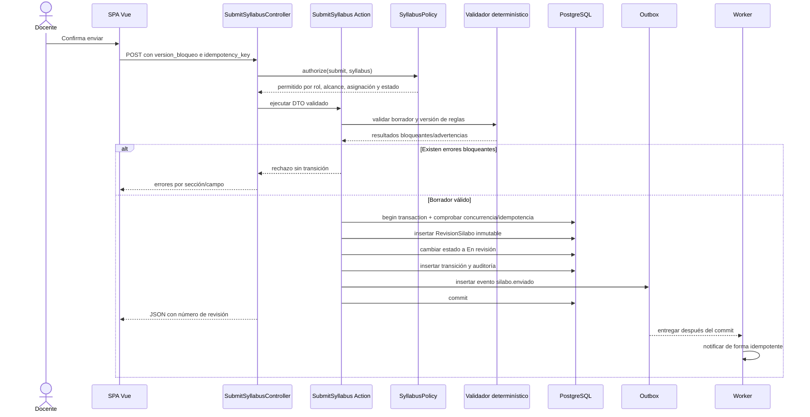
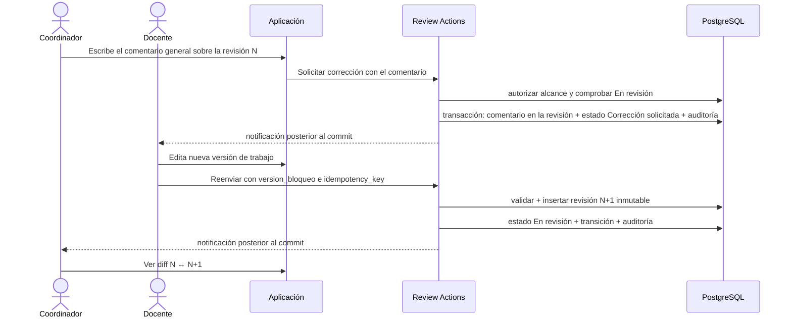
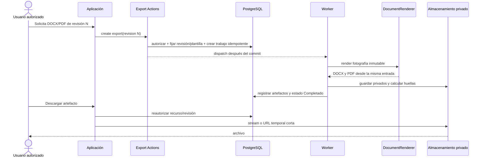
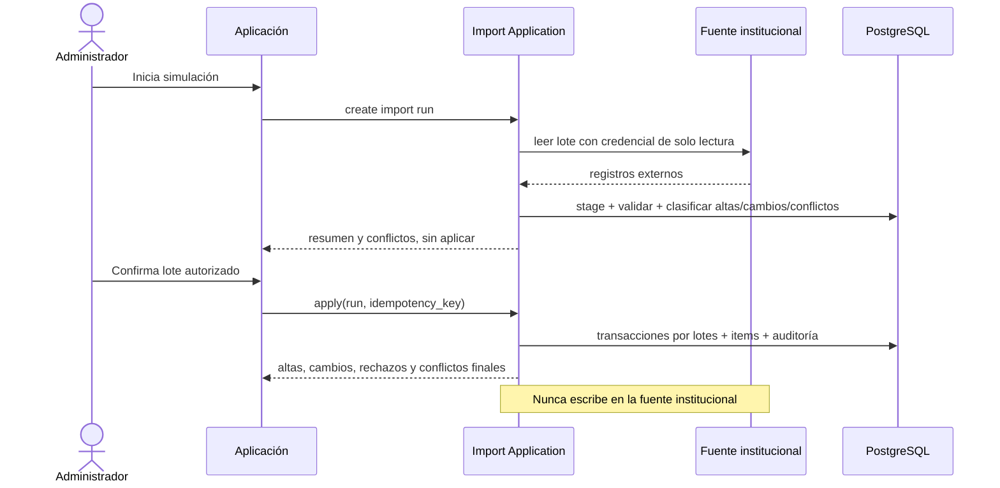

# Secuencias canónicas

Estos diagramas fijan responsabilidades e invariantes. Los nombres concretos de clases
pueden variar, pero no se omiten autorización, transacción, inmutabilidad, auditoría ni
efectos posteriores al commit.

## Enviar un sílabo



## Solicitar corrección y reenviar



## Aprobar y eliminar

```mermaid
sequenceDiagram
    actor Coo as Coordinador
    participant UI as SPA Vue
    participant A as Approval Actions
    participant DB as PostgreSQL
    participant O as Outbox

    Coo->>UI: Confirma aprobación de revisión N
    UI->>A: approve(revision N, idempotency_key)
    A->>DB: autorizar + validar estado/reglas
    A->>DB: transacción: Aprobacion(N) + estado Aprobado + auditoría + ejecución pendiente
    A-->>UI: Aprobado; revisión N bloqueada
    O-->>O: habilita notificación/exportación después del commit

    opt Eliminación autorizada (I-178)
        Coo->>UI: Confirma eliminar el sílabo aprobado
        UI->>A: DELETE sílabo
        A->>DB: autorizar + transacción
        A->>DB: borrar sílabo con revisiones, aprobación, PDF y firmas
        A->>DB: crear sílabo nuevo sin iniciar + auditoría + aviso al docente
        A-->>UI: sílabo nuevo sin iniciar
    end
```

## Solicitar contenido y unidades al chat (I-146)

```mermaid
sequenceDiagram
    actor D as Docente
    participant UI as SPA Vue
    participant A as SendSyllabusAiMessage
    participant DB as PostgreSQL
    participant Q as Redis/Worker
    participant AI as AiChatGateway

    D->>UI: Pregunta sobre contenido o unidades
    UI->>A: mensaje y clave idempotente
    A->>DB: autorizar sílabo y fijar contexto curricular-units-v1
    A->>DB: crear/reusar mensaje y contexto académico/curricular
    A-->>UI: estado Pendiente
    A-->>Q: job después del commit
    Q->>AI: contexto fotografiado, tablas de planificación y conversación compatible
    alt Respuesta válida
        AI-->>Q: propuesta y referencias al contexto recibido
        Q->>DB: validar referencias y persistir respuesta/evidencia
        Q-->>UI: respuesta disponible
        D->>UI: decide el contenido que incorpora mediante la edición normal
    else Timeout, fallo o cita inválida
        AI-->>Q: error
        Q->>DB: estado Fallido y diagnóstico seguro
        Q-->>UI: ayuda no disponible; flujo principal continúa
    end
```

No se consultan fuentes vivas ni vectores. El historial anterior permanece visible,
pero no se envía al proveedor bajo el contrato nuevo.

## Generar y descargar documentos



## Importar datos institucionales


