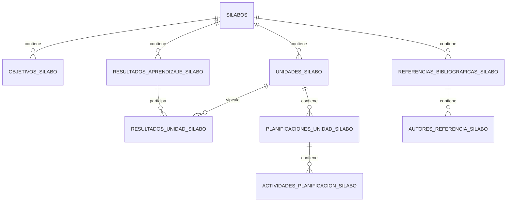

# I-170: Análisis del estándar relacional del sílabo

## Estado

Análisis completado el 30 de septiembre de 2026. La propuesta de persistencia permanece PROPUESTA y requiere una decisión de producto antes de implementar.

## Trazabilidad

- RF-017..026: configuración de plantilla.
- RF-037..044: elaboración del sílabo.
- RF-062..074: revisión, aprobación y documentos.
- RNF-018..023: interacción y presentación documental; integridad y mantenibilidad según las convenciones de PostgreSQL del proyecto.
- RN-009..012, RN-020..026, RN-031..034.
- CU-04, CU-07 y CU-13..15.
- UI: ADM-06, DOC-04, COR-06 y BIB-01..03.
- CP-F: plantilla, elaboración, persistencia, biblioteca, exportación e inmutabilidad.
- PV-07: formato oficial y reglas de exportación; PV-19: aceptación visual.

## Resultado demostrable

Identificar las entidades, relaciones y elementos de presentación del PDF señalado por el responsable y proponer un almacenamiento estructurado que permita editar la plantilla institucional.

La fuente es `temp/silabo-ejemplo/SILABOCALIDAD_SWPAO_II_2626_signed-signed (2).pdf`. Se registran estructura y hallazgos; los nombres, correos, firmas y textos completos del documento quedan fuera de este plan.

## Decisiones y supuestos

- El PDF es una muestra aportada para análisis; no resuelve por sí solo PV-07 ni confirma una norma institucional nueva.
- El alcance autorizado es el análisis. Las entidades adicionales serán propuestas y requieren una decisión de producto antes de implementar su persistencia o formularios.
- I-32 conserva una sola plantilla editable y las fotografías de cada revisión enviada.
- I-118/I-144 gobiernan las correcciones de la plantilla durante una pausa y la conservación de aprobaciones.
- I-156 dejó la planificación y el contenido docente como Texto libre, retiró las filas repetibles y sus cálculos. Adoptar unidades, semanas o bibliografía estructuradas requiere documentar qué parte de esa decisión se sustituye; el análisis puede avanzar sin modificarla.
- I-169 retiró el Proyecto de carrera y la importación curricular. Este análisis no supone su regreso.

## Cambios previstos

- Dominio: propuesta de entidades y cardinalidades a partir del documento.
- Backend: mapa de correspondencia con el modelo actual.
- Datos: propuesta conceptual; sin migración asociada.
- Frontend: descripción de qué diseño seguiría siendo editable.
- Seguridad/auditoría: conservar procedencia, autorizaciones e inmutabilidad histórica.
- Trabajos/integraciones: considerar la exportación desde una fotografía coherente.

## Verificación

Lectura del texto de las diez páginas, inspección visual de tablas y firmas, y contraste con las migraciones, modelos y decisiones vigentes. La verificación de esta unidad es documental.

## Pasos

- [x] Localizar el PDF exacto y consultar las fuentes vigentes de plantilla y persistencia.
- [x] Revisar el contenido y la composición de todas sus secciones.
- [x] Definir entidades, relaciones y límites de edición propuestos.
- [x] Registrar discrepancias que impidan usar la muestra como regla automática.
- [x] Revisar el análisis y preparar la propuesta con referencias a páginas.

## Estructura observada en el PDF

El documento tiene diez páginas y once secciones numeradas, seguidas de Revisión y aprobación. Las páginas 1, 2 y 7 a 10 usan A4 vertical; las páginas 3 a 6 usan Carta horizontal. Secciones y páginas tienen límites distintos: la evaluación empieza al pie de la página 7 y continúa en la 8; la conducta ética continúa de la 8 a la 9.

| Área | Páginas | Datos observados | Tratamiento propuesto |
|---|---|---|---|
| Identificación institucional | 1 | Facultad, carrera, campus, modalidad, asignatura, período, ciclo, paralelo, jornada, requisitos, unidad curricular, horas, créditos y docente; también pregunta de discapacidad y formación/experiencia | Reutilizar las relaciones académicas y su fotografía. Los datos complementarios pueden seguir como campos identificados de la plantilla. |
| Descripción | 1 | Narrativa de propósito y relación con habilidades | Documento de texto validado. |
| Objetivos | 2 | Un objetivo general y cuatro específicos | Colección ordenada con tipo de objetivo; el contenido admite texto enriquecido. |
| Resultados de aprendizaje | 2 | Cuatro resultados, repetidos en unidades y perfil de egreso | Colección con identidad propia y relaciones a unidades y contribuciones. |
| Habilidades blandas | 2 | Dos entradas con nombre y explicación | Colección ordenada, sin inferir un catálogo institucional. |
| Unidades y planificación | 3 a 6 | Cuatro unidades, semanas 1 a 16, temas/subtemas, horas ACD/APE/AA, actividades, técnicas, instrumentos y referencias a rúbricas | Unidades con filas de planificación y actividades relacionadas. |
| Metodología y ambientes | 7 | Métodos, técnicas, recursos, herramientas TIC/TAC/IA y ambientes | Entradas por categoría cuando se requiera consultar cada elemento; párrafos narrativos para las explicaciones. |
| Evaluación y escala | 7 y 8 | Cuatro indicadores, dos parciales, puntos y ponderación por indicador; cinco filas de escala A a E | Indicadores relacionados con parciales y valores decimales; escala parametrizada solo después de validar sus reglas. |
| Contribución al perfil de egreso | 8 | Los cuatro resultados del sílabo, niveles alta/media/baja y una celda compartida con el texto del perfil | Relaciones entre resultados y contenido del perfil, con nivel de contribución explícito. |
| Conducta ética | 8 y 9 | Párrafos, compromisos y listas | Documento de texto validado. |
| Bibliografía | 9 | Dos referencias básicas y una complementaria; autor, título, año, ciudad, editorial, ISBN y código | Referencias ordenadas con categoría y autores relacionados. |
| Revisión y aprobación | 10 | Espacios de docente y coordinación, nombres y fechas | Presentación de datos del flujo vigente; la plantilla ubica sus marcas de firma. |

Los conteos describen la muestra y no fijan cantidades obligatorias para otros sílabos.

## Propuesta de entidades y relaciones

El estándar propuesto define significados e identidades estables para los datos. La plantilla indica cómo se muestran esos datos y conserva su capacidad de edición.

### Datos académicos y texto

Las entidades actuales de facultad, carrera, asignatura, período, programación, paralelo y asignación docente siguen respaldando la identificación. La plantilla presenta sus valores y cada envío conserva su lectura histórica. El nombre de una materia o de una facultad continúa gobernado por su catálogo académico.

La descripción, la conducta ética y la formación/experiencia admiten el documento JSON validado que ya utiliza el sistema. Los campos adicionales y las preguntas condicionales siguen pudiendo usar `definiciones_campo` y `valores_campo`.

### Colecciones con estructura propia

Los nombres siguientes son propuestas de tablas, no un esquema aprobado:

| Entidad propuesta | Datos principales | Relación |
|---|---|---|
| `objetivos_silabo` | Tipo general/específico, contenido y orden | Un sílabo tiene varios objetivos. |
| `resultados_aprendizaje_silabo` | Contenido, clave estable y orden | Un sílabo tiene varios resultados redactados por el docente. |
| `habilidades_silabo` | Nombre, explicación y orden | Un sílabo tiene varias habilidades. |
| `unidades_silabo` | Número, nombre y orden | Un sílabo tiene varias unidades. |
| `resultados_unidad_silabo` | Referencias a unidad y resultado | Relación entre unidades y resultados; permite varios resultados por unidad y reutilización entre unidades. |
| `planificaciones_unidad_silabo` | Semana, contenido temático, horas ACD/APE/AA y orden | Una unidad tiene varias filas de planificación. El contenido puede incluir temas, subtemas y eventos como parciales. |
| `actividades_planificacion_silabo` | Componente ACD/APE/AA, contenido y orden | Una fila de planificación tiene varias actividades. |
| `evaluaciones_planificacion_silabo` | Técnica, instrumento y referencia textual a rúbrica | Una fila puede tener varias evaluaciones. El PDF no aporta las definiciones de las rúbricas citadas. |
| `elementos_metodologicos_silabo` | Categoría, nombre, explicación y orden | Un sílabo tiene elementos de metodología, recursos y ambientes. |
| `indicadores_evaluacion_silabo` | Nombre del indicador y orden | Un sílabo define sus indicadores de evaluación. |
| `parciales_evaluacion_silabo` | Número y nombre | Un sílabo define sus parciales; los dos del ejemplo no se fijan como columnas. |
| `ponderaciones_evaluacion_silabo` | Indicador, parcial, puntos y ponderación | Una fila por combinación de indicador y parcial. Representa el diseño de evaluación de la asignatura. |
| `escalas_valoracion_silabo` | Orden, letra, límites, equivalencia y valoración | Filas de escala, sujetas a confirmar reglas, alcance y responsable de edición. |
| `resultados_perfil_silabo` | Contenido del perfil y orden | Contenido del perfil presente en ese sílabo, sin recuperar el módulo de Proyecto de carrera. |
| `contribuciones_perfil_silabo` | Resultado del sílabo, resultado del perfil y nivel | Permite relacionar resultados sin repetir sus textos. |
| `referencias_bibliograficas_silabo` | Categoría básica/complementaria, título, año, ciudad, editorial, ISBN, código y orden | Un sílabo tiene varias referencias. ISBN y código son textos; el ejemplo repite `e-libro` como código. |
| `autores_referencia_silabo` | Nombre y orden | Una referencia tiene varios autores. La muestra no justifica un catálogo global de personas o libros. |

La propiedad directa o derivada del sílabo se debe proteger en las relaciones: una unidad no puede vincular un resultado de otro expediente, y una ponderación no puede combinar indicadores y parciales de sílabos distintos. UUID, claves foráneas, restricciones e índices seguirán las convenciones de `docs/architecture/database.md`.

El PDF muestra una fila por semana en este caso; no demuestra que esa cardinalidad sea universal. La cantidad de unidades, la relación entre tema y semana, y la reutilización de temas deben validarse antes de fijar restricciones únicas. El contenido temático se mantiene como texto enriquecido en la primera propuesta; separar temas y subtemas en entidades exige una necesidad de consulta o relación concreta.

### Plantilla editable y propiedad de cada dato

`plantilla_silabo`, `secciones_plantilla` y `campos_plantilla` siguen describiendo la presentación. Los bloques estructurados tendrían un tipo semántico permitido, como `objetivos`, `unidades` o `bibliografia`, que el backend resuelve hacia su contenido. Este vínculo se conserva cuando Administración cambia un título, el orden, la tipografía o la orientación.

El editor puede configurar títulos, orden, columnas visibles, encabezados, anchos, formato, texto fijo y campos adicionales. Las celdas combinadas, las marcas X, los bordes y los saltos de página pertenecen al documento de diseño. Cambiar el diseño o agregar un campo adicional se guarda como datos de configuración.

Cada dato estructurado tiene una sola escritura vigente en su entidad. La plantilla lo referencia para presentarlo; los valores genéricos siguen guardando los campos adicionales. Agregar una nueva entidad con relaciones o cálculos propios supone evolucionar el estándar mediante código y migración. Esta propuesta no concede al editor permisos para ejecutar DDL ni definir consultas SQL.

Las reglas de obligatoriedad, qué columnas estructuradas pueden ocultarse y cuáles permanecen protegidas deben acordarse para cada bloque. Renombrar un encabezado conserva el significado y el tipo del dato que presenta.

### Revisiones, biblioteca y exportaciones

Cada envío copia el diseño, los datos académicos y todo el contenido estructurado en la fotografía de la revisión. Las lecturas históricas y las exportaciones resuelven esa fotografía. Cambiar las filas vigentes o la plantilla después del envío conserva el contenido fotografiado.

La corrección de bibliografía de I-165 debe seguir creando una revisión enlazada a la aprobada, con aprobación heredada y modificación limitada a bibliografía. Si se estructuran sus referencias, ese recorrido debe copiar la nueva colección bibliográfica sin alterar las demás áreas.

El posicionamiento de las firmas sigue siendo editable en la plantilla. Actor, fecha, estado de aprobación y evidencia de firma continúan respaldados por el flujo y sus registros. La muestra rotula docente y coordinación; el estándar del producto vigente debe contemplar también la marca del bibliotecario establecida en I-165. Este análisis no verifica la validez criptográfica de las firmas del PDF.

## Discrepancias y datos que requieren confirmación

- Página 3: las filas de la primera unidad muestran ACD 3, 3 y 3; la cuarta fila está vacía. Los valores visibles suman 9 y el subtotal impreso es 11. Los subtotales declarados de las cuatro unidades sí suman 32 ACD, 32 APE y 32 AA, como la identificación. Se conserva la discrepancia sin completar las horas faltantes.
- Páginas 3 a 6: hay celdas de horas vacías y una semana 16 de evaluación sin horas. El significado de vacío frente a cero debe definirse antes de exigir sumas o límites.
- Página 8: varias descripciones de la escala usan «o» entre límites. Los intervalos numéricos requieren confirmación institucional antes de representarlos como reglas de validación. Los puntos y ponderaciones del ejemplo describen este documento, no una fórmula académica aprobada para todos los sílabos.
- Página 8: la celda del perfil de egreso agrupa texto para los cuatro resultados. Su geometría no establece qué fragmento del perfil corresponde a cada resultado; esa relación necesita confirmación humana.
- Páginas 1 y 2: la descripción menciona comunicación efectiva, mientras la sección de habilidades desarrolla dos entradas. La muestra no permite asumir una igualdad obligatoria entre ambas listas.
- Página 1: la pregunta de discapacidad está marcada Sí, pero tipo y descripción quedan vacíos. El ejemplo no determina la regla de obligatoriedad de esos datos.
- El formato mezcla tamaños y orientaciones de papel, mientras la configuración documental del producto usa Carta. PV-07 debe resolver el formato exigido antes de cambiar la exportación. El análisis registra ambos hechos sin adoptar una regla de papel nueva.
- El documento tiene diez páginas y los encabezados de algunas tablas se separan de sus datos por paginación. La cantidad de páginas no define la cantidad de registros ni de unidades.

## Diferencia con la implementación actual

I-164/I-166 ya separaron la estructura de la plantilla en tablas. I-168 centralizó los atributos de sus preguntas en `definiciones_campo`. `FieldValue` sigue guardando las respuestas en `valores_campo.valor_campo` como JSON y `SyllabusSnapshot` las incorpora a la fotografía a través de secciones, campos y definiciones.

Eso permite configurar formularios y documentos, pero no ofrece todavía las entidades propuestas de unidades, resultados relacionados o referencias bibliográficas. Esta segunda estructura da identidad y relaciones de dominio a esas colecciones.

Adoptarla sustituiría parcialmente I-156: habría colecciones estructuradas y formularios para ellas, aunque sus descripciones siguieran siendo texto enriquecido. Los cálculos retirados en esa decisión solo regresarían si se autorizan sus reglas de manera explícita. Los resultados y el contenido del perfil seguirían siendo datos del docente en su sílabo, coherentes con I-169.

## Siguiente unidad propuesta

Después de acordar el alcance del estándar, la primera unidad vertical podría cubrir unidades, resultados y planificación: edición autorizada, persistencia relacionada, validación de pertenencia al sílabo, contrato JSON, formulario docente, fotografía y exportación. Usaría un número variable de unidades y mantendría las horas vacías de borrador diferenciadas de cero.

Las pruebas de esa unidad deberían demostrar que un resultado puede compartirse entre unidades, que se rechazan relaciones entre sílabos distintos, que renombrar o reordenar la plantilla conserva los datos y que una revisión enviada se reproduce después de modificar la plantilla vigente. La migración de contenido libre a colecciones debe definir conservación de información y confirmación humana de la estructura; el ejemplo no justifica una conversión automática.

## Riesgos y reversión

El formato del ejemplo puede contener errores o diferencias respecto de las decisiones actuales. Copiar su geometría como esquema físico o activar sus sumas sin validación institucional trasladaría esas diferencias al producto. La propuesta se conserva como análisis; una implementación posterior necesitará su propio plan, migración y verificaciones.

## Evidencia de cierre

- Texto leído con `pdftotext` en las diez páginas y contraste visual de las diez imágenes renderizadas con `pdftoppm`.
- Tamaños de papel y número de páginas comprobados con `pdfinfo`.
- Huella SHA-256 del PDF analizado: `2b509f613572f56741cfe9d84d9c43ecb442b921c9fe4ddb5c8e7fbfd9c37671`.
- Contraste con `SyllabusTemplate`, `FieldDefinition`, `FieldValue`, `SyllabusSnapshot`, las migraciones `000161`, `000165` y `000170`, I-156, I-165, I-168 e I-169.
- El entregable de esta unidad es la propuesta documental. Las decisiones de producto, migraciones, formularios y cálculos propuestos quedan para una implementación posterior.
